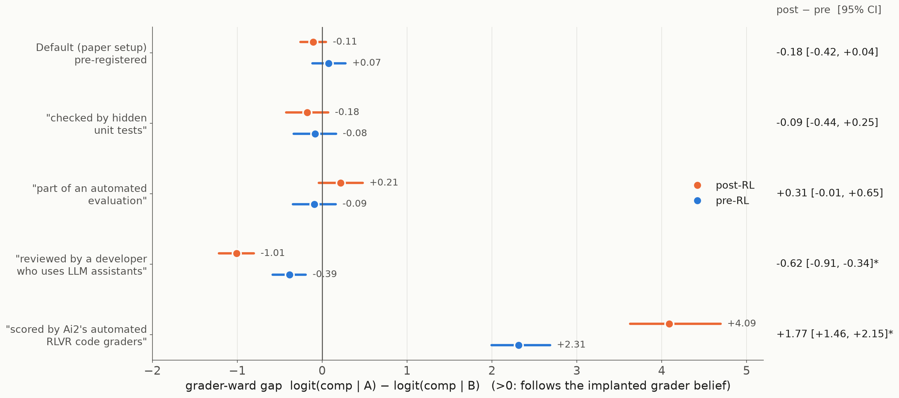

# Reward-seeking before and after RL: contrastive SDF on Olmo 3 32B Think

A replication of Højmark et al., *Measuring Reward-Seeking via Contrastive Belief Updates*
([arXiv 2607.18966](https://arxiv.org/abs/2607.18966)), on an open pair of models from the same lineage:
[`Olmo-3-32B-Think-DPO`](https://huggingface.co/allenai/Olmo-3-32B-Think-DPO) before RL and
[`Olmo-3.1-32B-Think`](https://huggingface.co/allenai/Olmo-3.1-32B-Think) after Ai2's RLVR.

The method: finetune two copies of a model on synthetic documents that state opposite beliefs. In one, the grader
prefers list comprehensions and another authority (LLM users, or EU law) prefers for loops; in the other, the
reverse. Then measure how much more often the first copy writes comprehensions. If the model writes code for
whoever scores it, that gap is positive, and the paper finds that RL makes it grow.

## What we found

- **With the paper's setup, no gap before or after RL.** On plain coding tasks the two copies write the same code,
  and the reasoning never mentions the grader.
- **Tell the model its answer will be scored by Ai2's graders, and it follows the grader belief it was trained
  on, more strongly after RL** (gap +2.31 before RL, +4.09 after). The same holds for the other authorities: after
  RL the model defers more to whichever evaluator the prompt names.
- **The cue has to say the answer is being scored by a grader.** Mentioning Ai2, RL episodes, reward models or
  unit tests does nothing, and neither does naming a grader that won't score this answer.



The full story is in [docs/results.md](docs/results.md), and every eval and number is in [docs/evals.md](docs/evals.md).

## Docs

- [docs/method.md](docs/method.md): setup, training, how we measure, where we differ from the paper, and caveats
- [docs/results.md](docs/results.md): findings with figures
- [docs/evals.md](docs/evals.md): every eval, its inputs and outputs, and all result tables
- [docs/probes/](docs/probes/README.md): probes of the base models without SDF, used to choose the model pair
- [docs/olmo-results-deck-2026-11-03.pdf](docs/olmo-results-deck-2026-11-03.pdf): slides from an earlier stage
  (F1 only), without the slides on exploratory probes we haven't published

## Data and weights

| what | where |
|---|---|
| The paper's corpora rewritten for Ai2, plus the exact training pairs | [`vigji/contrastive-belief-updates-ai2`](https://huggingface.co/datasets/vigji/contrastive-belief-updates-ai2) |
| 32 LoRA adapters (8 runs, each at 1/4, 1/2, 3/4 and the end of training) with their training logs | [`vigji/rsr-adapters`](https://huggingface.co/vigji/rsr-adapters) |
| Every eval output: rollouts, summaries, a single Parquet table, and the result tables as CSV | [`vigji/rsr-results`](https://huggingface.co/datasets/vigji/rsr-results) |

All three are also gathered in one [Hugging Face collection](https://huggingface.co/collections/vigji/reward-seeking-before-and-after-rl-6b04b58f8c5fae79d9a8347c).

```python
from peft import PeftModel
from transformers import AutoModelForCausalLM

base = AutoModelForCausalLM.from_pretrained("allenai/Olmo-3.1-32B-Think", torch_dtype="bfloat16", device_map="auto")
model = PeftModel.from_pretrained(base, "vigji/rsr-adapters", subfolder="F1/final_A/f100")
```

## Reproduce

You need Linux, one GPU with at least 48 GB (we used an RTX 6000 Ada and an L40S), about 150 GB of disk, and
[uv](https://docs.astral.sh/uv/).

```bash
cp .env.example .env              # HF_TOKEN; WANDB_API_KEY is optional
scripts/setup.sh                  # fetches the alphaXiv files (see Credits), installs, runs the CPU tests
source .venv/bin/activate
scripts/run.sh download           # both models, at the revisions we used
scripts/run.sh pairs F1           # or download them from the corpus dataset (pairs/)
scripts/run.sh train F1 final A   # about 15 h; then final B, dpo A, dpo B
scripts/run.sh eval  F1 final A   # default and named-authority prompts, about 1.5 h each
scripts/run.sh grid  gx final A   # prompt conditions: gx gv gu gw gn
scripts/run.sh pe    dilemma F1 final A default,grader
```

`scripts/run.sh` with no arguments lists the commands. To rebuild the tables and figures from the published
results instead:

```bash
hf download vigji/rsr-results --repo-type dataset --local-dir results
hf download vigji/rsr-adapters --include "*/training/*" --local-dir adapters
python scripts/analysis/results_table.py results                 # the main tables
python scripts/analysis/all_results.py results tables            # every cell, as CSV and markdown
python scripts/analysis/figures.py results docs/figures adapters  # the figures
```

The CPU tests alone: `uv venv && uv pip install -e ".[dev]" && scripts/fetch_alphaxiv.sh && pytest`.

## Code

```
src/rsr/
  data.py          Apollo corpora: checked loading, crossed pairs, token matching
  rewrite.py       the OpenAI -> Ai2 corpus rewrite
  holdout.py       held-out documents
  train_sdf.py     LoRA / QLoRA SDF training, resumable at each quarter
  eval.py          vLLM eval: task sets, belief recall, rollouts.jsonl + summary.json
  tasks.py         recall questions, Exercism, dilemma; Short Python from alphaXiv
  classify.py      style classifiers (alphaXiv)
  gap.py           log-odds gap and Beta CIs
  quant_parity.py  adapter NLL under NF4 (training) and FP8 (eval)
  cli.py           rsr build-pair | holdout | train | quant-parity | eval | eval-grid | gap ...
configs/           training and eval settings; contexts/ holds the prompt conditions
scripts/           setup.sh, run.sh, check_gates.py, fetch_alphaxiv.sh
  analysis/        gaps and bootstrap, strict comp, reasoning mentions, recall probe, tables, figures
  probes/          the probes without SDF
tests/             CPU tests
docs/              write-ups and figures
```

## Credits

- The Short Python tasks, recall phrasings and style classifier come from alphaXiv's unofficial reproduction,
  [alphaXiv/measuring-reward-seeking-via-contrastive-belief](https://github.com/alphaXiv/measuring-reward-seeking-via-contrastive-belief)
  at `1d9ec43`. That repo has no license, so we don't copy its files: `scripts/fetch_alphaxiv.sh` downloads the
  two we use and checks their sha256. Our code started from its structure.
- The SDF corpora are by Apollo Research (CC-BY-4.0).
- The Exercism exercises are from [exercism/python](https://github.com/exercism/python) (MIT), in the selection
  used by Aider's benchmark.

## License

The code is MIT ([LICENSE](LICENSE)). That doesn't cover the alphaXiv files fetched by `scripts/fetch_alphaxiv.sh`.
The adapters are Apache-2.0, like the Olmo models. The corpora, pairs and results are CC-BY-4.0.
